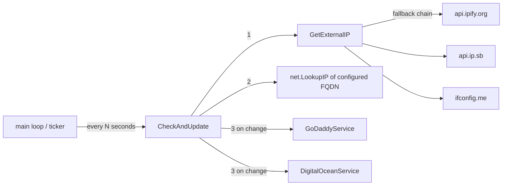

# nsdyndnsd Architecture

nsdyndnsd is a small daemon with a single responsibility: keep the A record
of a configured domain in sync with the host's external IP address.



## Components

### Main loop (`cmd/nsdyndnsd`)

- Parses flags (`-c` config path, `-i` interval, `-version`).
- Loads and validates the configuration, builds the list of name services.
- Runs a ticker loop; each tick calls `CheckAndUpdate` and logs failures
  without exiting — the daemon is resilient and keeps running.
- A `signal.NotifyContext` ctx (SIGINT/SIGTERM) is passed down, so an
  in-flight API call is cancelled on shutdown.

### External IP detection (`extaddress.go`)

- Tries a fixed preference list of services: `api.ipify.org`, then
  `api.ip.sb/ip`, then `ifconfig.me/ip`.
- Returns the first valid IP; errors fall through to the next service and
  the last error is returned when all fail.

### Shared HTTP layer (`http.go`)

- One shared `http.Client` with a 30 s timeout for all external calls.
- `doRequest` retries with exponential backoff (1 s, 2 s, up to 3 attempts)
  on 429, 5xx responses, and transient transport errors; other 4xx
  responses fail immediately.
- Callers pass a `requestBuilder` closure that builds a **fresh** request
  per attempt, because request bodies are single-use and must be
  re-created on retry.

### Name service interface (`service.go`)

```go
type NameService interface {
    SetAddress(ctx context.Context, domain, host string, address net.IP) error
}
```

- Providers are independent and upsert-style; all configured providers are
  updated on every change (errors are aggregated with `errors.Join`, not
  fail-fast).
- `recordName` maps an empty host to `@`, the conventional apex record
  name.

### Providers

- **GoDaddy** (`godaddy.go`): a single `PUT` to
  `domains/{domain}/records/A/{name}` — GoDaddy's upsert endpoint.
- **DigitalOcean** (`digitalocean.go`):
  1. `GET domains/{domain}/records` with pagination (200 per page, follow
     `links.next`) to find the existing A record id.
  2. `POST` if no record exists, otherwise `PUT domains/{domain}/records/{id}`.
  3. Verifies the response record's data and TTL actually match what was
     requested, surfacing a possible API-side failure.

### Configuration (`cmd/config.go`)

- YAML file; `domain` is required, at least one of `godaddy` /
  `digitalocean` must be present.
- `FullDomain()` resolves the FQDN used for the DNS lookup; an empty
  `host` means the apex domain.
- `GetNameServices()` builds the active provider list from whichever
  credentials are present.

## Failure modes

- DNS lookup failure, all IP services down, or provider API errors are
  logged and retried on the next tick; state is re-derived from scratch
  each cycle, so there is no persistent state to corrupt.
- On config errors at startup the daemon exits with a fatal log.
